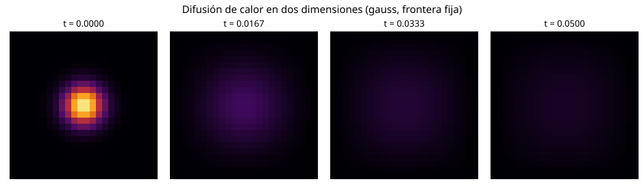

# Ecuación de calor en dos dimensiones

## Problema y método

Se resuelve la difusión de temperatura en una placa rectangular:

$$
\frac{\partial u}{\partial t}=\alpha\left(\frac{\partial^2u}{\partial x^2}+\frac{\partial^2u}{\partial y^2}\right),\qquad \alpha=c^2.
$$

Se usan diferencias finitas centradas en el espacio y Euler explícito en el tiempo (FTCS):

$$
u_{i,j}^{n+1}=u_{i,j}^{n}+r_x(u_{i+1,j}^{n}-2u_{i,j}^{n}+u_{i-1,j}^{n})
+r_y(u_{i,j+1}^{n}-2u_{i,j}^{n}+u_{i,j-1}^{n}).
$$

Aquí $r_x=\alpha\Delta t/\Delta x^2$ y $r_y=\alpha\Delta t/\Delta y^2$.
El paso temporal cumple $r_x+r_y\leq 1/2$, con factor de seguridad 0.9.

## Parámetros disponibles

| Parámetro | Valores |
|---|---|
| Condición inicial | `gauss`, `doble`, `seno` |
| Frontera | `fija` (temperatura cero) o `aislada` (flujo cero) |
| Malla | `nx`, `ny` (desde 3 puntos por eje) |
| Tiempo | Valor positivo |
| Difusividad y dimensiones | Constantes `ALFA`, `LX`, `LY` al inicio del código |
| Paralelismo en C++ | Número de hilos OpenMP |

En la frontera aislada se repite el valor de la celda del borde para representar flujo discreto nulo.

## Ejecución

Instalar las bibliotecas:

```bash
pip install -r requirements.txt
```

**Python:** solución y cuatro mapas de temperatura.

```bash
python calor.py gauss fija 81 81 0.05
python calor.py doble aislada 81 81 0.05
```

**C++:** mismo esquema, un hilo o varios hilos con memoria compartida.

```bash
g++ -O2 -fopenmp calor.cpp -o calor
./calor gauss fija 81 81 0.05 1
./calor gauss fija 81 81 0.05 4
```

## Rendimiento y aceleración OpenMP

Con 1 hilo se utiliza la ejecución secuencial; con 2 o 4 hilos se reparten las filas de la malla usando memoria compartida. Los hilos permanecen activos durante la simulación para evitar crearlos en cada paso.

Se compara **el mismo problema** (malla de 401 × 401, tiempo final 0.003, condición gaussiana y frontera fija). Para cada cantidad de hilos se calcula la mediana de tres mediciones y la aceleración:

$
S_p = \frac{T_1}{T_p}
$

Un valor $S_p > 1$ indica aceleración; un valor menor indica que el paralelismo fue más lento. Los tiempos dependen de la computadora y de su carga, por lo que no se garantiza una aceleración con cualquier número de hilos. La tabla siguiente se genera automáticamente en GitHub Actions, tras ejecutar el mismo programa C++ con 1, 2 y 4 hilos.

<!-- RESULTADOS_RENDIMIENTO -->

## Mapas de calor

Los mapas de temperatura se regeneran al ejecutar `calor.py`. Ejemplo de evolución:



## Documentación

La página utiliza MkDocs Material, como la tarea de cuadratura gaussiana. Para consultarla localmente:

```bash
mkdocs serve
```

La documentación se publica automáticamente en GitHub Pages tras superar las pruebas y construir el sitio.
